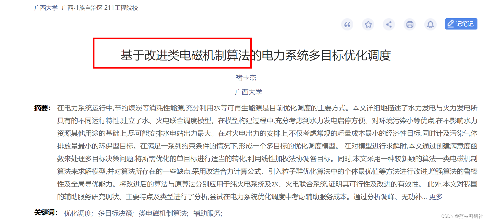
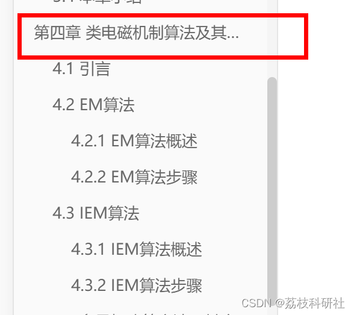
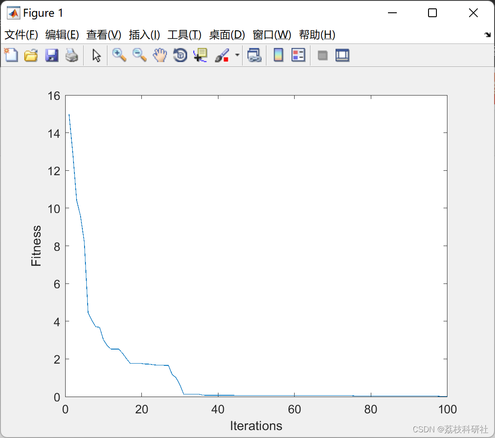

# Improved Class Electromagnetic Mechanism Algorithm (Matlab Code Implementation)

Edit:
Optimized Class Electromagnetic Mechanisms (IEM) is an improved version of the Class Electromagnetic Mechanisms (EM) algorithm.

Edit:
📚2 Run Results Edit
Part of the code:
clear all;
clc;
close all;
d=5; % dimension
options.lk=-32*ones(1,d); % lower bound
options.uk=32*ones(1,d); % upper bound
options.m=50; % Size of the population
options.m0=options.m; % m: number of initial sample points
options.MAXITER=100; % Maximum number of iterations
options.n=length(options.uk); % dimension of the problem.
options.IndexLB=0; % The index for local search on best sample or all points if IndexLB=1 local search on best only
options.LSITER=0; % LSITER: maximum number of local search iterations
options.delta=0.1; % local search parameter, [0, 1]
options.ObjFunction=@Ackley; % the name of the objective function  
options.Display_Flag=1; % Flag for displaying results over iterations  
options.run_parallel_index=0;  
options.run=5;  
if options.run_parallel_index  
stream = RandStream('mrg32k3a');  
parfor index=1:options.run  
%  tic  
%  index  
set(stream,'Substream',index);  
RandStream.setGlobalStream(stream)  
[bestX, bestFitness, bestFitnessEvolution]=IEM_v1(options);  
bestX_M(index,:)=bestX;  
Fbest_M(index)=bestFitness;  
fbest_evolution_M(index,:)=bestFitnessEvolution;  
end  
else  
rng('default')  
for index=1:options.run  
[bestX, bestFitness, bestFitnessEvolution,]=IEM_v1(options);  
bestX_M(index,:)=bestX;  
Fbest_M(index)=bestFitness;  
fbest_evolution_M(index,:)=bestFitnessEvolution;  
end  
end  
[a,b]=min(Fbest_M);  
figure  
plot(1:options.MAXITER,fbest_evolution_M(b,:))  
xlabel('Iterations')  
ylabel('Fitness')  
fprintf(' MIN=%g MEAN=%g MEDIAN=%g MAX=%g SD=%g \n',...  
min(Fbest_M),mean(Fbest_M),median(Fbest_M),max(Fbest_M),std(Fbest_M))  
🌈3 Matlab code implementation
🎉4 References
[2]Bouchekara, Houssem Rafik El-Hana, et al. "Optimal Power Flow Using an Improved Electromagnetism-like Mechanism Method." Electric Power Components and Systems, vol. 44, no. 4, Informa UK Limited, Jan. 2016, pp. 434–49, doi:10.1080/15325008.2015.1115919.  
​  

## Images

<!-- PAYMENT_BLOCK -->

## Get this dataset

- Payment link (Stripe): [Buy now](https://buy.stripe.com/3cs8yP7sY87d0vu9AB)
- Payment QR code: 

<!-- /PAYMENT_BLOCK -->
